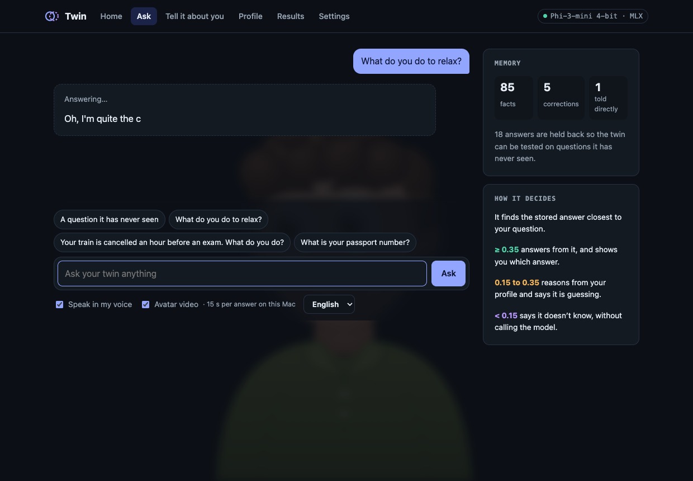

# Deferral Twin: an honest digital twin

A digital twin that answers questions the way one specific person would, in their own words, voice and face. When nothing the person said is close enough to the question, it says **"I don't know"** instead of guessing.

It runs entirely on a 16 GB Apple Silicon Mac, offline after setup, packaged as a macOS app (`DeferralTwin.app`).

**Final review, AI & ML, Team 8:** C Sai Hardhik (CB.AI.U4AID25112), Gagan Chowdary (CB.AI.U4AID25145), Charan Saatvikh (CB.AI.U4AID25124)



## What it does

- **Answers as you.** It retrieves your closest interview answers (sentence embeddings + FAISS) and writes a reply grounded in them with Phi-3-mini (4-bit, Apple MLX).
- **Defers when unsure (the core idea).** A confidence gate on retrieval similarity decides the tier:
  below 0.15 → "I don't know", 0.15–0.35 → a hedged answer, above 0.35 → a confident answer.
- **Learns without fine-tuning.** Corrections and notes go into memory and work immediately.
- **Speaks and appears as you, with consent only.** XTTS-v2 clones the voice from a short clip; Wav2Lip (+ optional GFPGAN) lip-syncs the photo; a LivePortrait character follows the cursor.
- **Extras:** optional Online mode (Google Gemini, with model fallback), Expert mode for the person's field, "Why this answer" evidence view, Telugu and Hindi, Talk mode (Whisper speech input), chat memory for follow-ups, "Guess me" game, "What would I do?" decisions, and a Big Five personality snapshot.

## Pipeline

```
Consent + interview + voice clip + photo
        │
        ▼
Facts (question–answer pairs) ──► all-mpnet-base-v2 embeddings ──► FAISS index
        │
Question ──► retrieve closest facts ──► confidence gate ──► refuse / hedge / answer
                                                   │
                                   Phi-3-mini (MLX)  or  Gemini (optional)
                                                   │
                                     XTTS-v2 voice ──► Wav2Lip video
```

## Results

| Evaluation | Setting | Result |
|---|---|---|
| Phase 1 | 100 people from Twin-2K-500 (Toubia et al., 2025), RAG + prompting | model 0.268 vs. human retest ceiling 0.887 (cosine similarity) |
| Phase 2 | one consenting person, 18 held-out questions | 25.9% → 56.9% of the person's own consistency ceiling after the answer-quality upgrade |

Speed on an M3 Mac with 16 GB (`BENCHMARK.md`): warm text answer about 1 s, voice about 0.9 s of compute per second of speech, Wav2Lip about 0.86 s per second of speech.

## Repository layout

| Path | What it is |
|---|---|
| `app/` | the desktop app's server (FastAPI) and window UI (`app/static/`) |
| `src/` | the twin itself: data loading, RAG, deferral gate, persona, LLM backends, voice and avatar, evaluation scripts |
| `bootstrap/` | first-run setup: machine check, resumable downloads, three Python environments, self-test |
| `packaging/` | builds `DeferralTwin.app` and the `.dmg` |
| `tests/` | API, gate, media, online, feature and setup tests |
| `notebooks/` | the original Colab notebooks (Phase 1 and the demo) |
| `docs/figures/` | evaluation figures |
| `HANDOFF.md`, `DESKTOP.md`, `MAC_RUN_REPORT.md` | design brief, desktop architecture, and the build and fix log |

## Running it

On an Apple Silicon Mac with 16 GB and macOS 14 or later:

```bash
./packaging/build_app.sh        # builds dist/DeferralTwin.app and dist/DeferralTwin.dmg
open dist/DeferralTwin.app      # the app downloads its models (about 10 GB) and sets itself up
```

For development, `./run.sh` opens the same app in a browser. Without any models (any OS), for working on the screens:

```bash
pip install -r requirements.txt fastapi "uvicorn[standard]" python-multipart opencv-python-headless
PYTHONHASHSEED=0 python scripts/dev_server.py --port 8000
```

Tests: `PYTHONHASHSEED=0 python tests/test_app.py` (and the other files in `tests/`), with ffmpeg on PATH.

Model weights are not in this repository; the app downloads them on first launch (`bootstrap/manifest.json`).

## Privacy and consent

Everything stays on the Mac unless Online mode is turned on. The voice and face features only work for the person who consented in the app. Benchmark participants are anonymous and never get a voice or face.

## Status

The macOS app is complete. A Windows version (llama.cpp instead of MLX, `bootstrap/manifest-windows.json`) is in progress and not yet tested on Windows.
